# Wind turbine parts

Parts of an onshore wind turbine after the IEA 3.4 MW reference design: tower, nacelle, drivetrain, rotor and service equipment, each with its healthy and faulty states.

57 objects from the wind turbine model by sorinar329 (`sorinar329/cognitive_robot_abstract_machine`, branch `windturbine_maintenance`). Each folder holds `model.urdf`, one `model_<state>.urdf` per fault state, `assets/*.glb`, `metadata.json` with the part's placement in the assembled turbine, `README.md`, `NOTICE.md`, `LICENSE.txt`, `rights.json` and `renders/rest.webp` (plus `renders/open.webp` for parts with moving joints).

The folders are generated; do not edit them by hand. To regenerate after a new turbine export:

```sh
python3 scripts/export_turbine_parts.py --source /path/to/cognitive_robot_abstract_machine
blender --background --factory-startup --python scripts/render_turbine.py
```

[INVENTORY.md](INVENTORY.md) lists every source GLB and where it went.

| Preview | Object | Size W × D × H (m) | Moving joints | Fault states |
| --- | --- | --- | --- | --- |
| 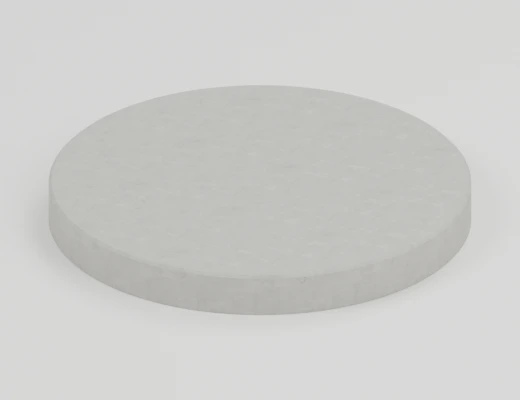 | **[#170 Turbine Foundation](./170-foundation/)**<br>Round concrete foundation plinth that the tower base stands on. | 7.80 × 7.80 × 0.80 | none | plinth_crack |
| 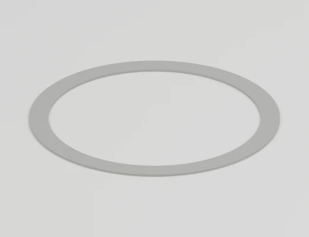 | **[#171 Foundation Grout Joint](./171-foundation_grout/)**<br>Grout bed between the foundation plinth and the tower's base flange, intact or broken out. | 6.44 × 6.44 × 0.06 | none | grout_breakout |
| 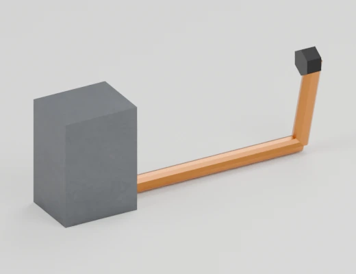 | **[#172 Foundation Earthing Strap](./172-foundation_earthing/)**<br>Earthing strap that bonds the tower base to the foundation's earth electrode, connected or loose. | 0.23 × 0.35 × 0.14 | none | earthing_disconnected |
| 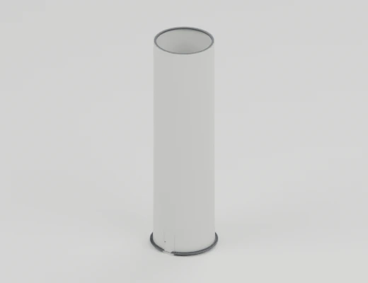 | **[#173 Tower Base Section with Door](./173-tower_section_1/)**<br>Lowest steel tower section with its base flange and anchor nuts, the upper flange and an entrance door that swings open. | 6.64 × 6.61 × 21.88 | 1 | anchor_nut_corrosion, base_coating_damage |
| 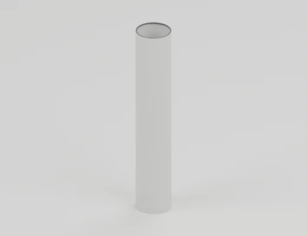 | **[#174 Tower Section 2](./174-tower_section_2/)**<br>Second steel tower section, with flanges at both ends. | 5.94 × 5.94 × 32.42 | none | — |
| 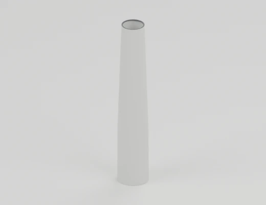 | **[#175 Tower Section 3](./175-tower_section_3/)**<br>Third steel tower section, with flanges at both ends. | 5.93 × 5.93 × 32.42 | none | — |
| 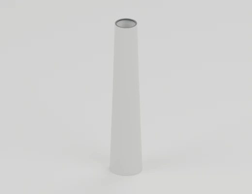 | **[#176 Tower Top Section](./176-tower_section_4/)**<br>Top steel tower section, ending at the yaw bearing flange. | 4.36 × 4.36 × 21.57 | none | — |
| 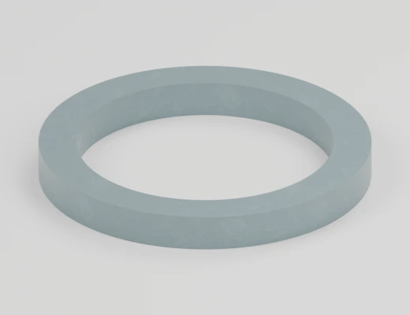 | **[#177 Yaw Bearing](./177-yaw_bearing/)**<br>Slewing ring on the tower top that the nacelle turns on. | 3.24 × 3.24 × 0.35 | none | — |
| 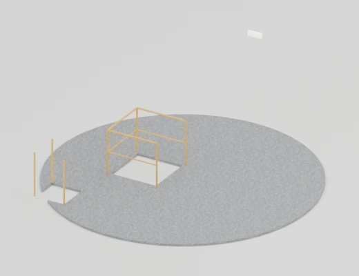 | **[#178 Tower Platform 1](./178-platform_1/)**<br>Grated rest platform under the flange at the top of tower section 1, with railings and openings for the ladder and the service lift. | 5.81 × 5.81 × 2.15 | none | — |
| 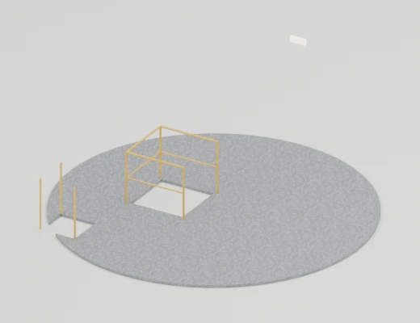 | **[#179 Tower Platform 2](./179-platform_2/)**<br>Grated rest platform under the flange at the top of tower section 2, with railings and openings for the ladder and the service lift. | 5.84 × 5.84 × 2.15 | none | — |
| 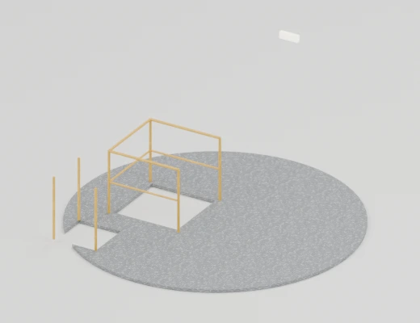 | **[#180 Tower Platform 3](./180-platform_3/)**<br>Grated rest platform under the flange at the top of tower section 3, with railings and openings for the ladder and the service lift. | 4.37 × 4.37 × 2.15 | none | — |
| 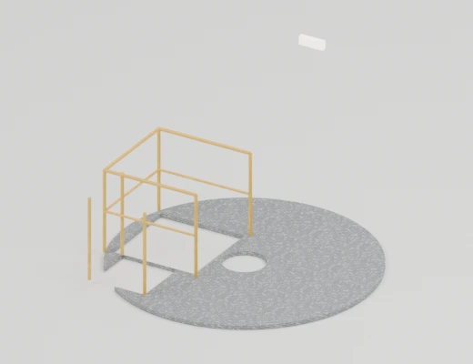 | **[#181 Tower Platform 4](./181-platform_4/)**<br>Grated yaw deck at the top of the tower, with railings and openings for the ladder, the service lift and the cable loop. | 3.08 × 3.08 × 2.15 | none | — |
| 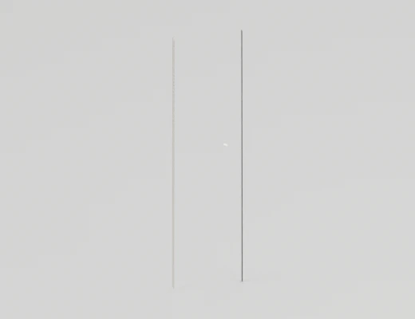 | **[#182 Tower Ladder 1](./182-ladder_1/)**<br>Ladder with fall-arrest rail, power cables and a wall lamp, running up tower section 1. | 4.12 × 4.93 × 21.61 | none | — |
|  | **[#183 Tower Ladder 2](./183-ladder_2/)**<br>Ladder with fall-arrest rail, power cables and a wall lamp, running up tower section 2. | 4.12 × 4.94 × 32.41 | none | — |
| 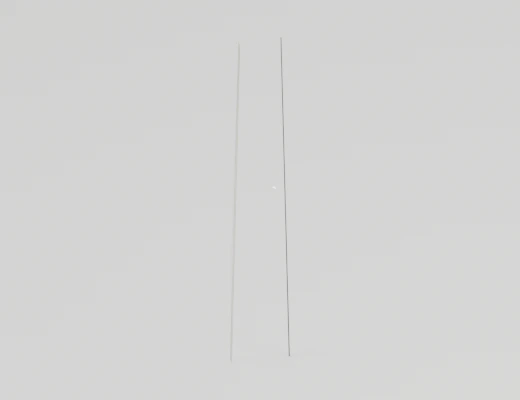 | **[#184 Tower Ladder 3](./184-ladder_3/)**<br>Ladder with fall-arrest rail, power cables and a wall lamp, running up tower section 3. | 4.12 × 4.74 × 32.41 | none | — |
| 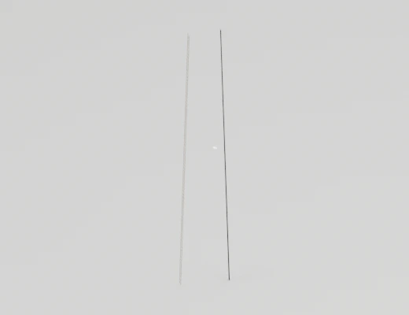 | **[#185 Tower Ladder 4](./185-ladder_4/)**<br>Ladder with fall-arrest rail, power cables and a wall lamp, running up tower section 4. | 3.02 × 3.25 × 21.57 | none | — |
| 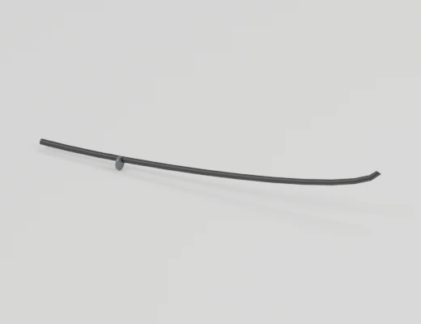 | **[#186 Tower Cable Loop](./186-cable_loop/)**<br>Drooping loop of the power cables below the yaw deck that lets the nacelle turn. | 1.43 × 1.43 × 10.08 | none | cable_loop_chafed |
| 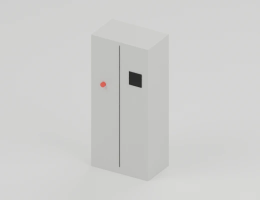 | **[#187 Tower Base Controller](./187-ground_controller/)**<br>Ground controller cabinet at the tower base, opposite the door. | 0.90 × 0.59 × 2.00 | none | — |
| 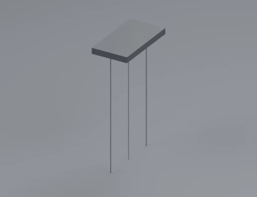 | **[#188 Service Lift Rails](./188-lift_rails/)**<br>Guide and hoist wires of the service lift with their top anchor, running up the whole tower. | 0.60 × 1.10 × 107.81 | none | — |
| 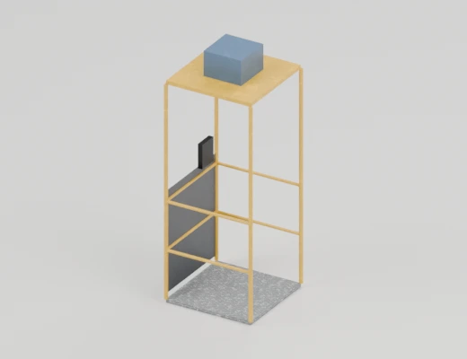 | **[#189 Service Lift Car](./189-service_lift/)**<br>Open service lift car with railings, a roof hoist and a control panel. | 0.94 × 0.94 × 2.54 | none | — |
| 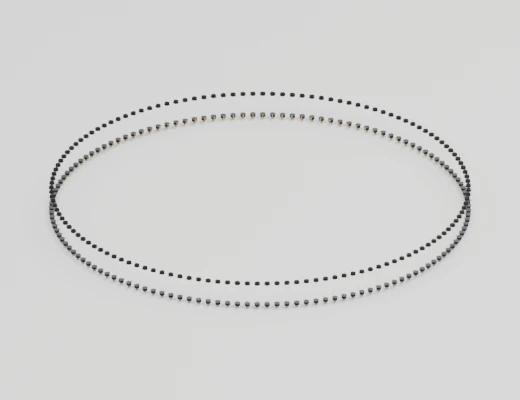 | **[#190 Tower Flange 1 Bolts](./190-flange_1_bolts/)**<br>Ring of bolts with torque markings that joins tower section 1 to the section above. | 5.69 × 5.69 × 0.38 | none | — |
| 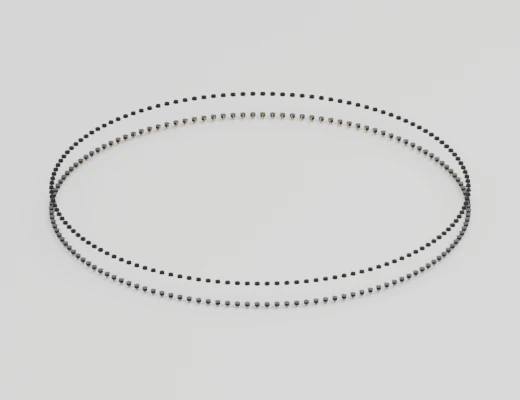 | **[#191 Tower Flange 2 Bolts](./191-flange_2_bolts/)**<br>Ring of bolts with torque markings that joins tower section 2 to the section above. | 5.72 × 5.72 × 0.38 | none | flange_2_bolts_loose |
| 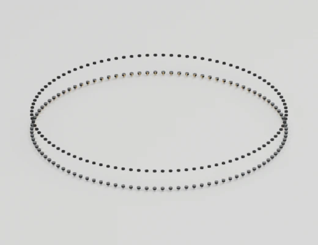 | **[#192 Tower Flange 3 Bolts](./192-flange_3_bolts/)**<br>Ring of bolts with torque markings that joins tower section 3 to the section above. | 4.16 × 4.16 × 0.37 | none | flange_3_bolts_loose |
| 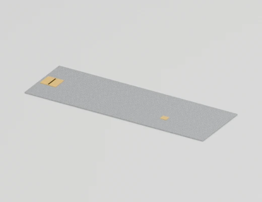 | **[#193 Nacelle Floor with Hatches](./193-nacelle_floor/)**<br>Floor grating of the nacelle with a hinged tower access hatch and the crane hatch at the rear. | 12.48 × 4.08 × 0.11 | 2 | — |
| 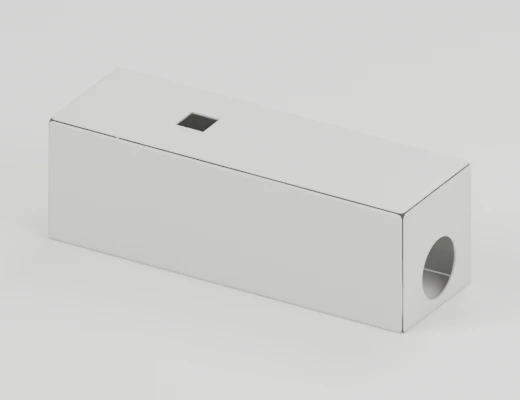 | **[#194 Nacelle Cover](./194-nacelle_cover/)**<br>Glass-fibre shell over the nacelle, open at the bottom. | 12.60 × 4.20 × 4.11 | none | cover_crack |
| 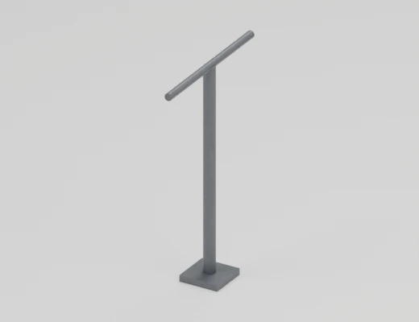 | **[#195 Nacelle Weather Mast](./195-weather_mast/)**<br>Mast on the nacelle roof that carries the anemometer, the wind vane and the aviation light. | 0.30 × 1.10 × 1.65 | none | — |
| 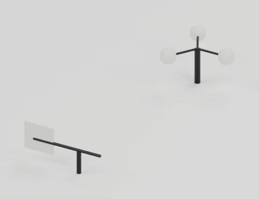 | **[#196 Cup Anemometer](./196-anemometer/)**<br>Cup anemometer on the weather mast, intact or damaged. | 0.50 × 1.29 × 0.22 | none | anemometer_damaged |
| 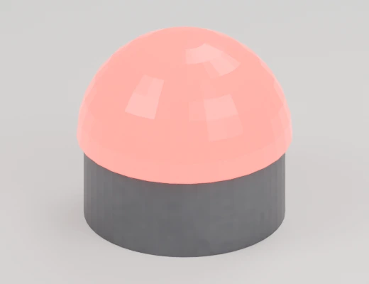 | **[#197 Aviation Obstruction Light](./197-aviation_light/)**<br>Red obstruction light on the weather mast, working or broken. | 0.15 × 0.15 × 0.13 | none | aviation_light_failed |
| 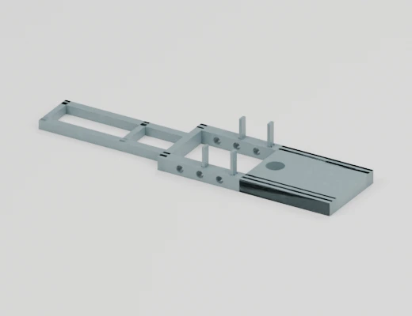 | **[#198 Bedplate](./198-bedplate/)**<br>Cast front bedplate with side girders for the main bearing and the gearbox torque arms, and a welded rear frame for the generator and transformer. | 10.60 × 2.60 × 1.23 | none | — |
| 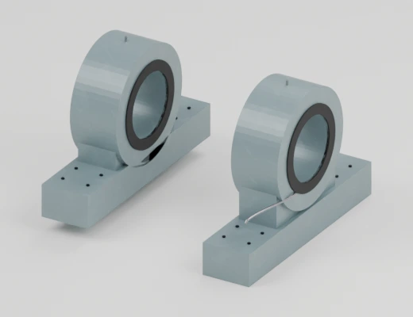 | **[#199 Main Bearing](./199-main_bearing/)**<br>Main bearing housing that carries the rotor shaft. | 2.37 × 2.30 × 1.67 | none | grease_leak_front_seal |
|  | **[#200 Main Bearing Grease Collector](./200-grease_collector/)**<br>Transparent grease collector under the main bearing, normal or full. | 0.12 × 0.12 × 0.21 | none | grease_collector_full |
| 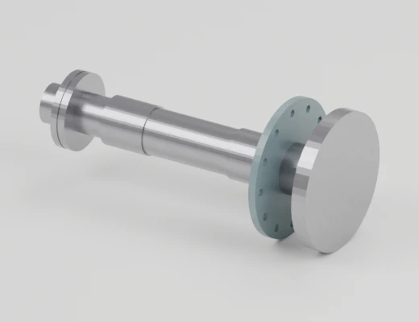 | **[#201 Main Shaft](./201-main_shaft/)**<br>Low-speed rotor shaft between the hub flange and the gearbox. | 4.20 × 1.80 × 1.80 | none | fretting_corrosion |
| 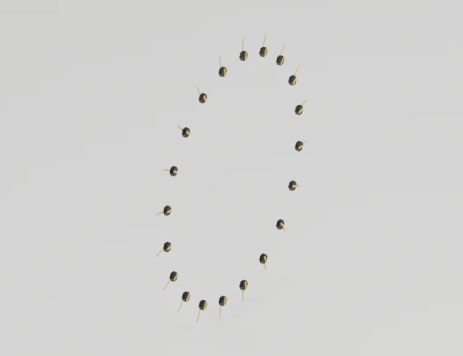 | **[#202 Shrink Disc Bolts](./202-shrink_disc_bolts/)**<br>Bolt ring of the shrink disc that clamps the main shaft to the gearbox, tight or loose. | 0.02 × 0.95 × 0.95 | none | shrink_disc_bolt_loose |
| 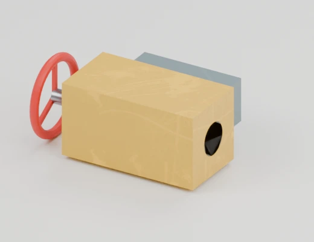 | **[#203 Rotor Lock with Pin](./203-rotor_lock/)**<br>Rotor lock block beside the main bearing with a locking pin that slides into the hub flange. | 0.47 × 0.33 × 0.22 | 1 | — |
|  | **[#204 Rotor Hub](./204-hub/)**<br>Cast rotor hub with three blade flanges and a spinner. | 4.86 × 4.89 × 4.36 | none | — |
| 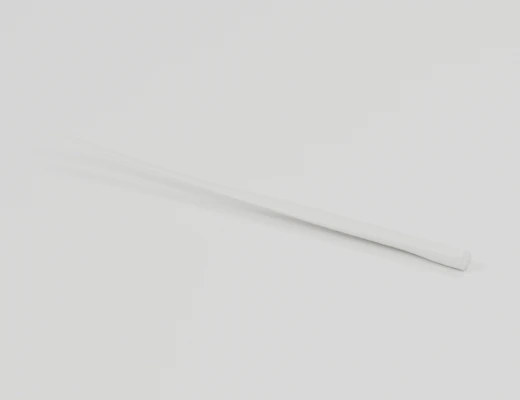 | **[#205 Rotor Blade](./205-blade/)**<br>63 m rotor blade lofted from the IEA-3.4-130-RWT data, from the root flange to the tip. | 3.87 × 4.52 × 63.00 | none | leading_edge_erosion, lightning_damage, trailing_edge_crack |
| 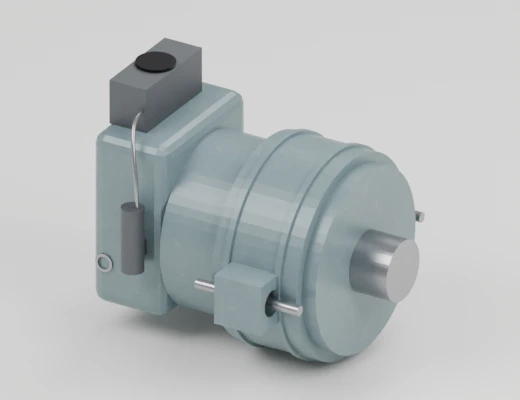 | **[#206 Gearbox](./206-gearbox/)**<br>Gearbox with torque arms and oil cooler, between the main shaft and the generator. | 3.10 × 2.60 × 2.51 | none | oil_leak_input_seal |
| 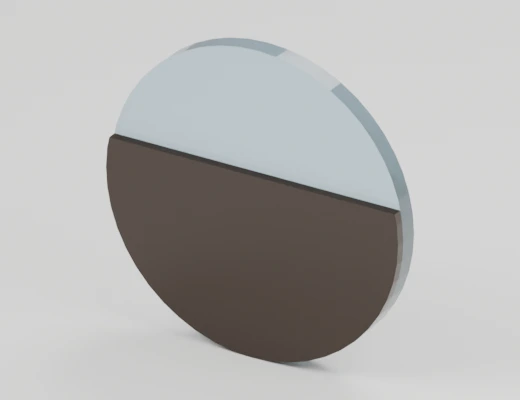 | **[#207 Gearbox Oil Sight Glass](./207-gearbox_sight_glass/)**<br>Oil level sight glass on the gearbox, full or low. | 0.13 × 0.01 × 0.13 | none | oil_level_low |
|  | **[#208 Gearbox Filter Indicator](./208-gearbox_filter_indicator/)**<br>Pop-up clogging indicator of the gearbox oil filter, normal or clogged. | 0.04 × 0.04 × 0.01 | none | filter_clogged |
| 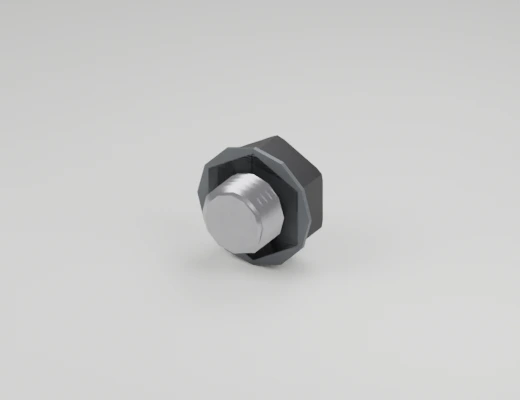 | **[#209 Gearbox Cover Bolts](./209-gearbox_cover_bolts/)**<br>Bolts of the gearbox inspection cover, complete or one missing. | 0.45 × 0.01 × 0.45 | none | cover_bolt_missing |
| 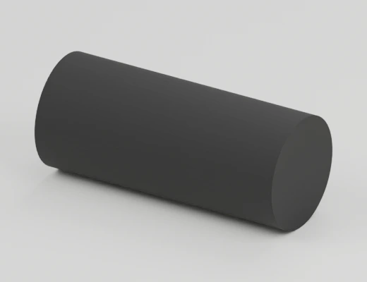 | **[#210 Gearbox Torque Arm Bushing](./210-gearbox_bushing/)**<br>Elastomer bushing of the gearbox's left torque arm, intact or cracked. | 0.60 × 0.26 × 0.26 | none | torque_arm_bushing_cracked |
| 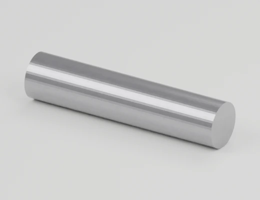 | **[#211 High-Speed Shaft](./211-fast_shaft/)**<br>High-speed shaft with coupling hubs, from the gearbox output to the generator. | 1.30 × 0.29 × 0.29 | none | — |
| 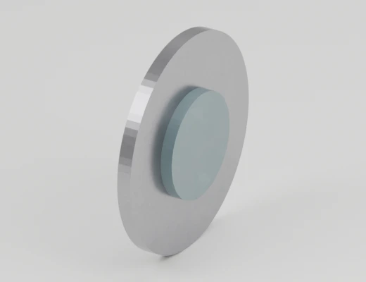 | **[#212 Rotor Brake Disc](./212-brake_disc/)**<br>Brake disc on the high-speed shaft, normal or overheated. | 0.16 × 0.90 × 0.90 | none | disc_overheated |
| 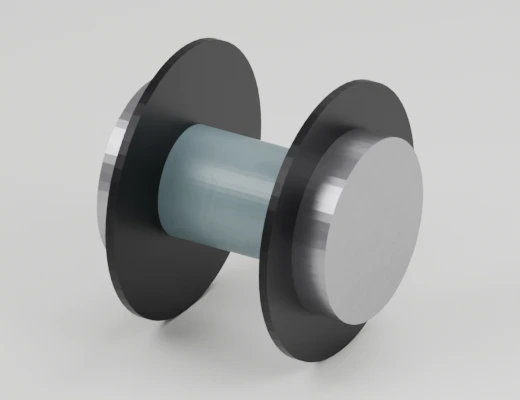 | **[#213 Shaft Coupling](./213-coupling/)**<br>Flexible disc-pack coupling to the generator, intact or cracked. | 0.55 × 0.60 × 0.60 | none | disc_pack_cracked |
| 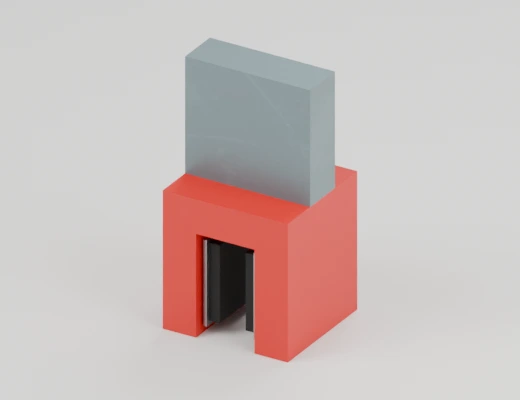 | **[#214 Rotor Brake Caliper](./214-brake_caliper/)**<br>Brake caliper straddling the top of the brake disc, with normal or worn pads. | 0.30 × 0.28 × 0.59 | none | pads_worn |
| 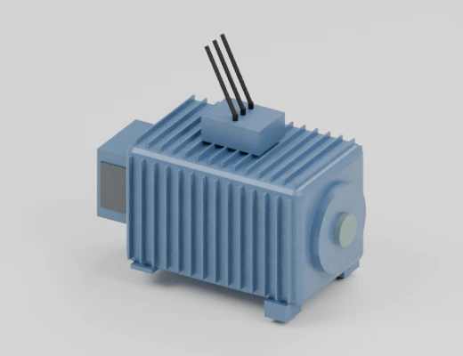 | **[#215 Generator](./215-generator/)**<br>Doubly fed induction generator with finned housing, end shields, feet, terminal box and slip-ring housing. | 3.30 × 1.70 × 3.09 | none | slip_ring_carbon_dust, terminal_box_overheating |
| 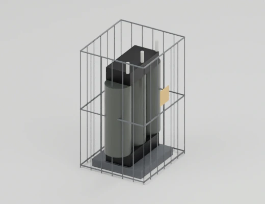 | **[#216 Nacelle Transformer](./216-transformer/)**<br>Transformer with three cast-resin coils on a core frame inside a mesh cage. | 1.33 × 1.48 × 2.32 | none | — |
| 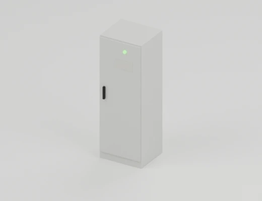 | **[#217 Converter Cabinet with Door](./217-cabinet_converter/)**<br>Power converter cabinet with a hinged door that carries a status light, normal or showing an error. | 0.70 × 0.66 × 2.00 | 1 | fault_light |
| 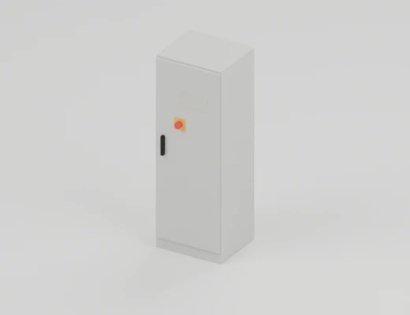 | **[#218 Controller Cabinet with Door](./218-cabinet_controller/)**<br>Turbine controller cabinet with a hinged door. | 0.70 × 0.67 × 2.00 | 1 | — |
| 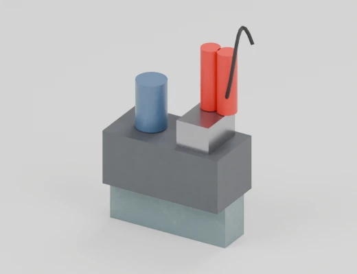 | **[#219 Hydraulic Unit](./219-hydraulic_unit/)**<br>Hydraulic unit with tank, motor and valve block, and its hose to the brake caliper. | 1.69 × 1.31 × 2.22 | none | hose_leak |
| 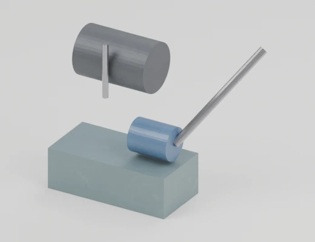 | **[#220 Cooling Unit](./220-cooling_unit/)**<br>Cooling unit with pump and expansion tank. | 1.23 × 0.85 × 1.20 | none | — |
| 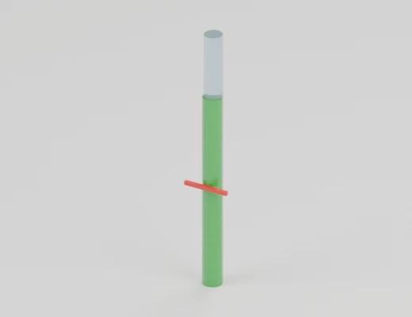 | **[#221 Coolant Level Gauge](./221-coolant_level/)**<br>Level gauge on the cooling unit's expansion tank, normal or low. | 0.06 × 0.03 × 0.34 | none | coolant_low |
| 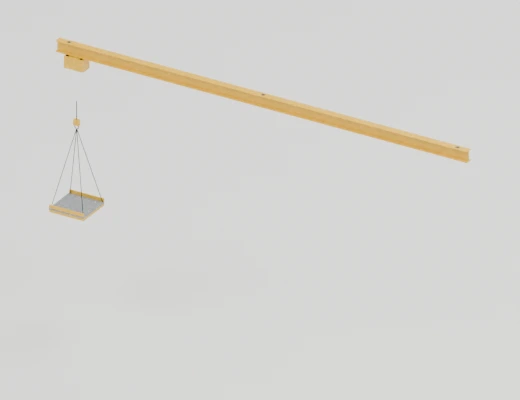 | **[#222 Nacelle Service Crane](./222-service_crane/)**<br>Crane rail under the nacelle roof with a travelling trolley and a hoist hook carrying a lifting platform. | 10.70 × 0.90 × 4.13 | 2 | — |
| 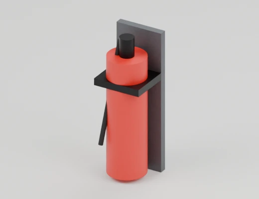 | **[#223 Fire Extinguisher](./223-fire_extinguisher/)**<br>Wall-mounted fire extinguisher, present or missing from its bracket. | 0.20 × 0.21 × 0.60 | none | extinguisher_missing |
|  | **[#224 First-Aid and Emergency-Stop Boxes](./224-safety_equipment/)**<br>First-aid box and emergency-stop box on the nacelle walls by the tower hatch. | 1.17 × 4.08 × 0.32 | none | — |
|  | **[#225 Tool Rack](./225-tool_rack/)**<br>Steel tool rack with two shelves against the nacelle wall. | 0.63 × 0.32 × 1.30 | none | — |
|  | **[#226 Tool Tray](./226-tool_tray/)**<br>Tool tray on a post on the bedplate girder. | 0.40 × 0.27 × 0.43 | none | — |
